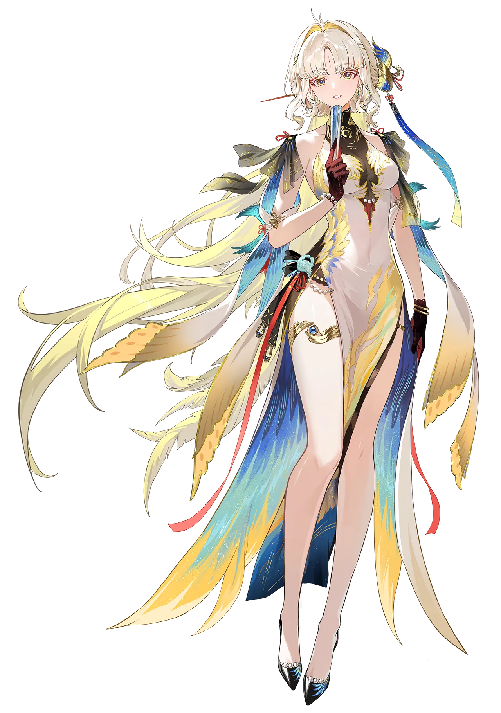

# 漂泊者桌面精灵（Fengyu Desktop Pet）

基于 Electron + Canvas 的 Windows 桌面精灵。透明无边框窗口中显示一只可拖拽、会呼吸摆动、跟随鼠标、点击有反馈的立绘桌宠，支持**缩放**、**特效开关**与**多角色切换**。




---

## ✨ 功能特性

- **真实立绘桌宠**：自动抠白底，呼吸缩放 / 鼠标跟随倾斜 / 点击弹跳 / 悬停光晕。
- **星光特效**：环绕闪烁星光（可关闭）+ 点击迸发爱心/星星（始终有）。
- **自由拖拽**：按住人物拖动到桌面任意位置；指针捕获，拖拽不脱手。
- **大小调节**：设置面板滑块 30%–150% 实时缩放，窗口随之缩放并记忆。
- **多角色切换**：设置面板角色画廊一键切换；立绘、台词、气泡与面板配色、特效色**随角色整体换肤**，热切换无需重启。
- **系统托盘 + 右键菜单**：设置、置顶、隐藏、鼠标穿透、退出。
- **配置记忆**：大小、特效、当前角色持久化到用户目录。

---

## 📁 目录结构

```
fengyu-desktop-pet/
├── main.js              # 主进程：窗口/托盘/菜单/IPC/角色注册表/配置持久化
├── preload.js           # contextBridge 暴露 petAPI（渲染进程与主进程的安全桥）
├── index.html           # 桌宠窗口（#stage 画布 + #bubble 气泡）
├── app.js               # 渲染层：Canvas 逐帧绘制、动画、特效、交互
├── character.js         # 立绘加载 + 洪水填充抠白底
├── settings.html        # 设置面板：角色画廊 + 大小 + 特效
├── pack.js              # 打包脚本（支持按角色打包）
├── assets/
│   ├── char.png         # 穗穗立绘（被 characters/fengyu 复用）
│   └── characters/      # 角色注册表
│       ├── fengyu/meta.json        # 穗穗（金褐主题）
│       └── fengyu-azure/meta.json  # 演示变体（青蓝主题，用于验证切换，可删）
├── icon.ico / icon.png  # 应用与托盘图标
├── agent.md             # 「如何用一张图新增一个角色」开发指南
└── README.md
```

---

## 🚀 运行方式

### 环境要求

- Node.js（含 npm）
- Windows x64

### 安装依赖

```powershell
npm install
```

### 启动开发运行

```powershell
npm start
```

等价于 `electron .`。若 `npm` 的 shim 环境异常，也可直接运行：

```powershell
node_modules\electron\dist\electron.exe .
```

> 注意：Electron 需要写入用户目录（`%APPDATA%\穗穗桌面精灵\`）来保存配置，请勿在受限沙箱内运行，否则可能启动失败。

---

## 📦 打包命令

打包使用 `@electron/packager`，产物输出到 `dist/`。

```powershell
# 打包全部角色
npm run pack
# 或
node pack.js
```

### 只打包指定角色（其余角色不进包）

在 `pack.js` 后面跟上角色 id（即 `assets/characters/` 下的目录名）：

```powershell
# 只打包穗穗，其他角色不会被打进产物
node pack.js fengyu

# 打包多个指定角色
node pack.js fengyu fengyu-azure

# 通过 npm 传参（注意 -- 分隔）
npm run pack -- fengyu
```

- 传入的角色 id 必须存在，否则会报错并列出可用角色。
- 未选中的角色目录会通过 `ignore` 规则排除，**不会进入安装包**；共享的 `assets/char.png` 始终保留。
- 打包后若用户配置里记录的角色恰好被排除，程序会自动回退到包内第一个可用角色。

---

## 🎮 使用说明

| 操作                   | 效果                                   |
| ---------------------- | -------------------------------------- |
| 左键拖动人物           | 移动桌宠位置                           |
| 单击人物               | 弹跳 + 迸发爱心/星星 + 随机台词        |
| 双击人物               | 特别台词                               |
| 右键人物               | 上下文菜单（设置/置顶/隐藏/穿透/退出） |
| `Ctrl + ,`           | 打开设置面板                           |
| `Esc` / `Ctrl + Q` | 退出                                   |
| 托盘图标双击           | 显示 / 隐藏                            |

**设置面板**（右键菜单或托盘「设置…」进入）：

- **角色**：点击缩略图切换角色，即时预览、自动保存。
- **人物大小**：滑块或 小/中/默认/大 预设。
- **星光特效**：开关环绕星光。

---

## ➕ 新增一个角色

准备一张（纯白背景的）全身立绘，在 `assets/characters/` 下新建目录并写 `meta.json` 即可，**通常无需改代码**。详见 [`agent.md`](./agent.md) 的完整规范与配色指引。

最小示例：

```
assets/characters/my-char/
  char.png
  meta.json   # { "id":"my-char", "name":"显示名", "image":"char.png", "theme":{...}, "lines":[...] }
```

---

## 🛠 技术栈

Electron 31 · 原生 JavaScript · HTML5 Canvas · 无运行时依赖、无构建步骤。
